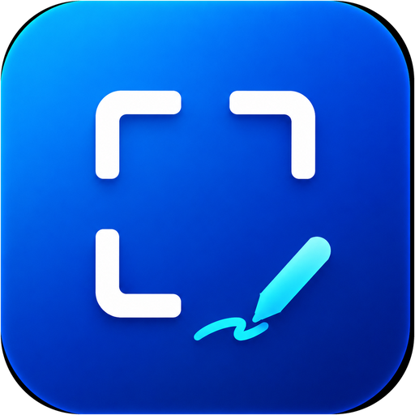

<p align="center">
  
</p>

<h1 align="center">Pixnip</h1>

<p align="center">
  Screenshots that look right on HDR monitors — with a fast, modern markup editor.
</p>

---

## Why

With HDR enabled, Windows' built-in Snipping Tool captures the raw framebuffer, so
screenshots of normal (SDR) content come out washed out and blown out. Pixnip
captures in FP16 via Windows.Graphics.Capture and tone-maps against each
monitor's actual SDR white level, so captures look exactly like your screen.

## Features

- **HDR-correct capture** — per-monitor tone mapping; SDR content stays true, HDR highlights compress gracefully
- **PrintScreen region picker** with window snap (or a Ctrl+Alt+S hotkey if you'd rather keep Windows' default)
- **Markup editor** — pen, neon, highlighter, arrows, shapes, text with background pills, blur/redact, step badges, crop
- **Direct manipulation** — tap anything to select, drag to move, grip to resize, tap a swatch to recolor
- **Drag out** — pull the annotated shot straight into Slack, a browser upload box, or Explorer
- **Tray app** — auto-saves to `Pictures\Screenshots` and copies to the clipboard

## Install

Grab the installer from [Releases](../../releases). Builds are currently
unsigned, so SmartScreen may ask you to confirm — a Microsoft Store release
is in the works.

## Build from source

Requires [Rust](https://rustup.rs/) (MSVC toolchain), [Node.js](https://nodejs.org/) 18+,
and the [Tauri prerequisites](https://tauri.app/start/prerequisites/).

```sh
npm install
npm run tauri dev    # run in development
npm run tauri build  # produce a release build
```

> **Screenshots not saving?** If your Pictures folder is OneDrive-redirected,
> Windows' Controlled Folder Access may silently block unsigned builds.
> Allow the exe under Windows Security → Ransomware protection, or Pixnip
> falls back to `%LOCALAPPDATA%\Pixnip\Screenshots`.

## License

[MIT](LICENSE)
